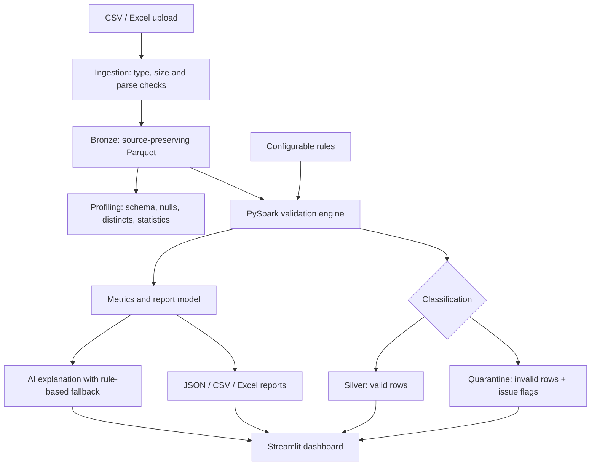

# Architecture and Phase 1 Requirements

## Business requirements

The application accepts a customer dataset in CSV or Excel format, profiles it, applies configurable quality rules, separates valid records from records with one or more issues, and produces metrics, explanations, and downloadable reports. The initial public demonstration target is 10,000 rows per run. Input values must remain available in the Bronze layer; validation must add issue information without silently changing the source values.

The application must be useful without an LLM or credentials. AI receives aggregate metrics and a small set of carefully redacted examples only. Its output is advisory and cannot edit records. The first release targets local execution and Streamlit Community Cloud; Spark processing is local and bounded by the hosting environment. Larger distributed workloads are a future extension, not a current scalability claim.

## Proposed component architecture

## Data flow

1. The UI accepts only supported file extensions and passes the upload to the ingestion layer. Ingestion validates size and parseability, records file metadata, and reads CSV/Excel. Source fields are treated as strings where practical so malformed values are retained for validation instead of being coerced away.
2. The pipeline adds a stable internal row identifier and persists the ingested records as Bronze Parquet. Original column values are retained; technical metadata is stored separately or under reserved internal names.
3. Profiling produces column-level counts and safe descriptive statistics. It must avoid exposing personal data in the UI or AI prompt.
4. A rule registry loaded from YAML applies independently configurable checks using PySpark expressions. Rule results are attached as issue codes/details; a record may have multiple issues.
5. Rows with no issues are written to Silver. Rows with one or more issues are written to Quarantine. Neither output overwrites Bronze.
6. Metrics, report exports, and optional AI explanations are built from validation aggregates. The non-AI explanation path always works.

## Technology choices

| Technology | Role | Reason |
| --- | --- | --- |
| Python 3.12 | Application and pipeline | Common, maintainable ecosystem for data engineering and Streamlit |
| PySpark | Core validation and classification | Meets the distributed-processing learning goal and avoids expressing core rules as Pandas-only operations |
| Pandas / openpyxl | Excel upload and small-file boundary handling | Convenient Excel reader; convert into Spark promptly for the core workflow |
| Streamlit | Upload, dashboards, inspection, downloads | Fast, free-to-host demonstration UI |
| Parquet | Bronze, Silver, Quarantine | Columnar, typed, query-friendly storage |
| YAML | Rule configuration | Human-readable rule settings separate from Python implementation |
| SQL | Optional future PostgreSQL integration and query examples | Keeps the storage boundary extensible without adding a database dependency now |
| Optional LLM API | Plain-language explanation | Aggregate-only prompt, optional configuration, graceful fallback; no paid service required for core use |

Spark and Java availability will be checked in Phase 2. Streamlit Cloud resource limits and local Spark execution constrain the public demo, so the 10,000-row target must be verified in the eventual environment before making performance claims.

## Initial logical schema

The sample customer schema is intentionally small and configurable: `customer_id` (string key), `first_name` (string), `last_name` (string), `email` (string), `phone` (string), `age` (integer-like), `signup_date` (date-like), `country` (string), and `customer_status` (allowed-value string). Incoming extra/missing columns are handled through schema rules rather than assumed to be identical.

Every pipeline output also carries `_dq_row_id` (stable row identity for this run), `_dq_issue_codes` (array of rule identifiers), `_dq_issue_details` (human-readable rule findings), and `_dq_is_valid` (boolean). These are generated fields and must be collision-checked against user columns.

## Quality metric definitions

- Total records: input row count.
- Valid / invalid records: rows with zero / one or more failed rules; these must sum to total records.
- Duplicate records: rows participating in a duplicate `customer_id` group, including the first occurrence, because every row in a conflicting key group is affected.
- Missing values: total blank or null cells across configured fields, reported alongside field-level counts.
- Invalid email, phone, date: number of rows failing the corresponding enabled rule.
- Overall quality percentage: `100 × valid records / total records`; empty input has no percentage (display as unavailable), not 100%.

## Security and operational boundaries

Uploads and outputs are local/ephemeral by default; do not log cell values. Bound upload size and accepted formats, handle malformed inputs with actionable errors, and avoid storing secrets in the repository. AI prompts contain aggregates and redacted or synthetic examples only. Public hosting is for demonstration and is not a durable or regulated data service.
